# Documento de diseño: Servicio de paquetería

Proyecto final de Programación Orientada a Objetos. Brigada 8.

**Contenido**

| **N.º** | **Diagrama**                        | **Tipo UML**                           |
|---------|-------------------------------------|----------------------------------------|
| 1       | Organización en paquetes            | Diagrama de paquetes                   |
| 2       | Funciones del sistema por actor     | Diagrama de casos de uso               |
| 3       | Panorama general de clases          | Diagrama de clases (vista de conjunto) |
| 4       | Modelo de envíos y tarifas          | Diagrama de clases (detalle)           |
| 5       | Estados del envío (patrón State)    | Diagrama de clases (detalle)           |
| 6       | Servicios y operaciones del sistema | Diagrama de clases (detalle)           |
| 7       | Persistencia y reloj                | Diagrama de clases (detalle)           |
| 8       | Repartidores y reparto concurrente  | Diagrama de clases (detalle)           |
| 9       | Jerarquía de excepciones            | Diagrama de clases (detalle)           |
| 10      | Ciclo de vida de un envío           | Diagrama de máquina de estados         |
| 11      | Cotizar y registrar un envío        | Diagrama de secuencia                  |
| 12      | Jornada de reparto concurrente      | Diagrama de secuencia                  |
| 13      | Importación de envíos desde CSV     | Diagrama de actividad                  |


# 1. Introducción

## 1.1 Propósito y alcance

El proyecto pide diseñar e implementar, en equipo, un sistema orientado a objetos en Python para una empresa de paquetería. El enunciado indica **qué** debe hacer el sistema y deja al equipo la decisión de **cómo** construirlo. Este documento presenta esa decisión: las clases, sus responsabilidades, sus relaciones y el comportamiento más importante, expresados en UML.

Los diagramas describen el diseño objetivo del sistema. Como el enunciado exige que **los diagramas coincidan con el código entregado**, los nombres de clases, atributos y métodos aquí usados son los que debe tener la implementación; al terminar el código se revisaron y se actualizaron los diagramas 4, 5, 6, 7, 8 y 10 para que coincidan con él.

## 1.2 Notación utilizada

| **Elemento**                               | **Significado en los diagramas**                                                                                     |
|--------------------------------------------|----------------------------------------------------------------------------------------------------------------------|
| \+ - \#                                    | Visibilidad pública, privada y protegida. En Python es una convención (\_atributo), no una restricción del lenguaje. |
| Nombre en *cursiva*                        | Clase o método abstracto (clase que hereda de ABC, método con @abstractmethod).                                      |
| «value object»                             | Objeto inmutable que solo agrupa datos (@dataclass(frozen=True)).                                                    |
| «enumeration»                              | Conjunto fijo de valores (enum.Enum).                                                                                |
| «interface»                                | Clase abstracta sin atributos que define solo un contrato.                                                           |
| Flecha con triángulo hueco, línea continua | Herencia (generalización): la clase del triángulo es la superclase.                                                  |
| Flecha con triángulo hueco, línea punteada | Realización: la clase implementa el contrato de una clase abstracta o interfaz.                                      |
| Rombo relleno                              | Composición: la parte no existe sin el todo y lo acompaña en su ciclo de vida.                                       |
| Rombo vacío                                | Agregación: el todo agrupa partes que existen por sí solas.                                                          |
| Flecha abierta, línea continua             | Asociación dirigida: una clase conoce y usa a otra de forma permanente. Los números son multiplicidades.             |
| Flecha abierta, línea punteada             | Dependencia: una clase usa o crea a otra de forma ocasional.                                                         |

Los colores solo ayudan a leer: amarillo para clases abstractas, verde para estados, morado para servicios, turquesa para concurrencia, rojo claro para persistencia y gris para objetos de valor.

## 1.3 Resumen del sistema

El sistema cotiza y registra envíos, los rastrea, cambia su estado respetando las reglas, asigna los envíos del almacén a repartidores sin exceder la capacidad de su vehículo, importa envíos de clientes empresariales desde CSV, genera el reporte diario, conserva todo entre ejecuciones y simula una jornada de reparto con un hilo por repartidor. Los tipos de envío y sus reglas son:

| **Tipo de envío**   | **Reglas de precio y restricciones**                                                                                                                            |
|---------------------|-----------------------------------------------------------------------------------------------------------------------------------------------------------------|
| Sobre               | Tarifa fija según la zona de destino.                                                                                                                           |
| Paquete             | Se cobra por kilogramo según la zona, usando el mayor entre el peso real y el volumétrico (largo × ancho × alto / 5000, en cm).                                 |
| Paquete frágil      | Como el paquete, con 20 % adicional y seguro obligatorio de 3 % del valor declarado.                                                                            |
| Paquete refrigerado | Solo servicio express y no puede ir a la zona nacional.                                                                                                         |
| Servicio            | Estándar: 3 a 5 días. Express: al día siguiente, 50 % más.                                                                                                      |
| Estados             | Registrado → en almacén → en ruta → entregado. Intento fallido: regresa al almacén; al tercero se devuelve al remitente. Solo se cancela antes de salir a ruta. |
| Repartidores        | Motocicleta (20 kg) o camioneta (500 kg).                                                                                                                       |

# 2. Supuestos de diseño

El enunciado indica que, cuando un detalle queda sin definir, el equipo decide cómo resolverlo y lo documenta. Estas son las decisiones que los diagramas reflejan:

| **N.º** | **Tema**                    | **Decisión**                                                                                                                                                                                                                                    |
|---------|-----------------------------|-------------------------------------------------------------------------------------------------------------------------------------------------------------------------------------------------------------------------------------------------|
| 1       | Orden del cálculo           | Base (peso cobrado × tarifa por kg, o tarifa fija del sobre) → se suma el 20 % si es frágil → se aplica el factor del servicio (×1.5 en express). El seguro de 3 % se suma al final y no recibe el recargo express.                             |
| 2       | Peso de un sobre            | Constante de 0.1 kg solo para controlar la capacidad del vehículo; el cobro del sobre es la tarifa fija.                                                                                                                                        |
| 3       | Peso para capacidad         | Se usa el peso real. El peso volumétrico solo sirve para cobrar.                                                                                                                                                                                |
| 4       | Zona por código postal      | ResolvedorZona toma los dos primeros dígitos del código postal y los busca en datos/zonas.csv. Un código sin regla se rechaza con DatoInvalidoError.                                                                                            |
| 5       | Estados adicionales         | Se agregan Devuelto (al remitente) y Cancelado como estados finales; el enunciado nombra solo cuatro.                                                                                                                                           |
| 6       | Intento fallido             | EnRuta → EnAlmacen aumenta intentos_fallidos. Al tercero, el envío pasa a Devuelto en lugar de volver al almacén.                                                                                                                               |
| 7       | Asignación a repartidores   | Asignar marca repartidor_id y reserva capacidad; el envío sigue en almacén hasta que el hilo del repartidor sale a ruta. Algoritmo: first-fit decreasing por peso. Los que no caben quedan en almacén. Si se cancela, se retira del repartidor. |
| 8       | Número de guía              | Formato PQ-AAAAMMDD-NNNN; el contador se conserva entre ejecuciones y se protege con un Lock. Cotizar no consume guía; solo registrar.                                                                                                          |
| 9       | Fecha y hora                | Toda operación recibe la fecha de un Reloj. RelojSimulado se fija desde la terminal (por ejemplo --fecha-hora "2026-11-20 10:30") para probar reglas de fecha sin esperar.                                                                      |
| 10      | Persistencia                | Archivos JSON en un directorio de ejecución (ignorado por git). La escritura es atómica: archivo temporal y os.replace.                                                                                                                         |
| 11      | Importación CSV             | Usa las mismas reglas que el registro manual. Un renglón inválido se informa con su número y motivo y no detiene la importación.                                                                                                                |
| 12      | Cliente empresarial         | Se representa con el remitente de cada renglón. No hay clase Cliente porque ninguna función la necesita.                                                                                                                                        |
| 13      | Dirección del remitente     | Contacto.codigo_postal es obligatorio y Contacto.direccion es opcional; la zona se calcula solo con el código postal del destinatario.                                                                                                          |
| 14      | Reintentos en la simulación | Un envío con intento fallido vuelve al almacén y el mismo repartidor lo reintenta al final de su ruta, hasta entregarlo o devolverlo al tercer intento.                                                                                         |
| 15      | Ingresos del reporte        | El reporte suma Envio.total(), que sale de la cotización guardada al registrar. Si las tarifas cambian después, los envíos ya registrados conservan su precio.                                                                                  |
| 16      | Qué cuenta el reporte       | Ingresos: envíos registrados ese día, sin contar los cancelados. Envíos por estado: los que tuvieron algún movimiento ese día, con su estado actual. Entregas: las hechas ese día, por repartidor. |
| 17      | Salir a ruta a mano         | Un envío asignado a un repartidor sale a ruta solo en la simulación; el cambio manual a ruta se rechaza para no descuadrar la carga del repartidor. |
| 18      | Fechas en orden             | Un cambio de estado con fecha anterior al último movimiento del envío se rechaza con DatoInvalidoError. |
| 19      | Repartidores iniciales      | En la primera ejecución se cargan de datos/repartidores.json; después se conservan en el directorio de ejecución. |
| 20      | Teléfonos                   | Remitente y destinatario requieren teléfono de 10 dígitos; nombre y código postal (5 dígitos) son obligatorios. |

# 3. Mejoras añadidas al enunciado

Todas las mejoras usan únicamente temas del curso (POO, UML, SOLID, excepciones, flujos de E/S, hilos y patrones) y la biblioteca estándar.

| **Mejora**                              | **Tema del curso**         | **Beneficio**                                                                                                                     |
|-----------------------------------------|----------------------------|-----------------------------------------------------------------------------------------------------------------------------------|
| Patrón State para los estados del envío | Patrones de comportamiento | Las transiciones válidas viven en cada estado; desaparecen los if/elif y las reglas de intentos fallidos quedan en un solo lugar. |
| Template Method en Envio.cotizar()      | Patrones de comportamiento | El cálculo tiene un esqueleto fijo y cada tipo redefine solo su parte (costo base, recargo, seguro).                              |
| Strategy con Servicio                   | Patrones de comportamiento | Estándar y express son intercambiables; un servicio nuevo no obliga a modificar Envio.                                            |
| Factory FabricaEnvios                   | Patrones de creación       | Un único punto crea envíos desde el menú y desde el CSV, con las mismas validaciones.                                             |
| Observer con CentralMonitoreo           | Patrones de comportamiento | La central muestra el avance y escribe una bitácora sin acoplar los hilos a la salida.                                            |
| Facade SistemaPaqueteria                | Patrones estructurales     | La terminal usa una sola clase y no conoce a las demás.                                                                           |
| Repository con escritura atómica        | E/S, SOLID (D)             | Cambiar de JSON a otro formato no toca la lógica; un corte a mitad de escritura no daña los datos.                                |
| Reloj inyectable                        | SOLID (D), pruebas         | Cumple el requisito de probar reglas de fecha indicando la fecha de cada operación.                                               |
| Objetos de valor inmutables             | Encapsulamiento            | Cotizacion, RegistroEstado y Dimensiones no se alteran por accidente.                                                             |
| Jerarquía de excepciones propias        | Manejo de excepciones      | Mensajes claros y un solo except PaqueteriaError en la terminal; ningún traceback al usuario.                                     |
| Pruebas unitarias con unittest          | Pruebas de software        | Se verifican tarifas, transiciones, capacidad, importación y la simulación concurrente.                                           |

# 4. Diagramas UML

Cada diagrama indica qué muestra y por qué se eligió, como pide el enunciado. Las imágenes están en docs/uml/. Los diagramas 4, 5, 6, 7, 8 y 10 incluyen también su código fuente de Graphviz (`.dot`).

## 1. Organización en paquetes

**Tipo UML:** Diagrama de paquetes

**Qué muestra.** Cómo se reparte el código en paquetes y módulos y qué paquete usa a cuál.

**Por qué se eligió.** El enunciado exige organizar el código en paquetes. Este diagrama permite revisar que las dependencias vayan en un solo sentido (terminal → servicios → modelo) y que no haya ciclos.

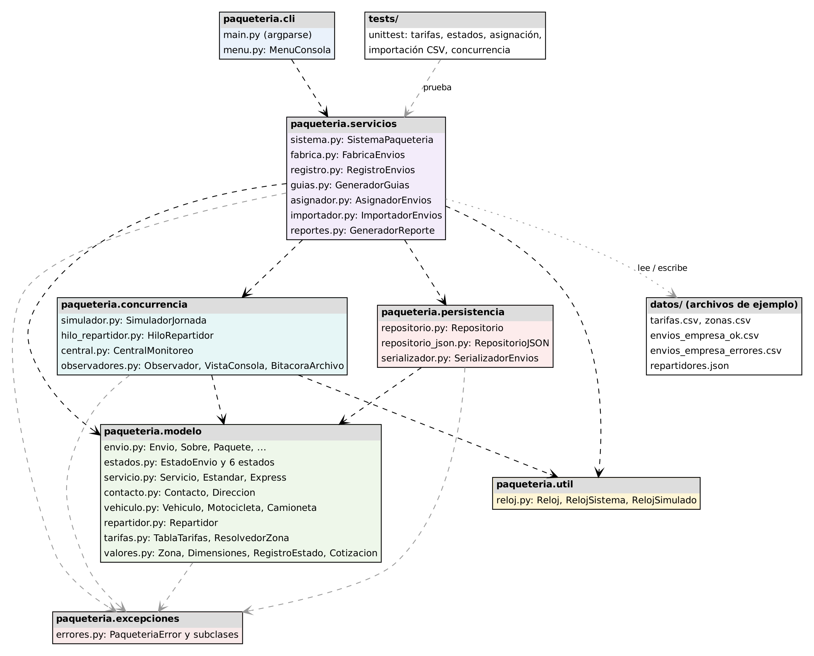

*Figura 1. Paquetes y módulos del sistema*

### Elementos clave

- cli solo depende de servicios: la terminal no conoce al modelo ni a la persistencia.

- modelo no depende de ningún otro paquete del sistema salvo excepciones, así que se puede probar solo.

- excepciones y util son transversales: cualquier paquete puede usarlos.

- tests/ y datos/ están fuera del paquete principal; datos/ contiene los archivos de ejemplo, incluidos los que traen errores.

## 2. Funciones del sistema por actor

**Tipo UML:** Diagrama de casos de uso

**Qué muestra.** Quién usa el sistema y qué puede hacer: las funciones mínimas que alguien pide directamente y la cancelación de envíos. La función 7 (conservar los datos) no aparece como caso de uso porque nadie la pide: el sistema guarda después de cada operación.

**Por qué se eligió.** Es la vista más cercana al enunciado, así que sirve para confirmar que no falta ninguna función antes de entrar al diseño de clases.

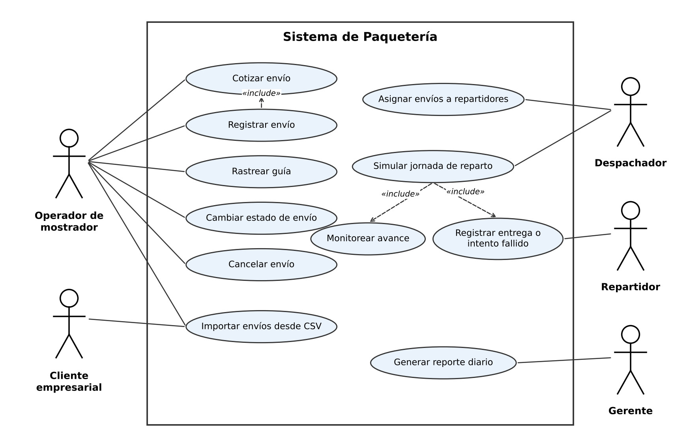

*Figura 2. Casos de uso del sistema de paquetería*

### Elementos clave

- **Operador de mostrador:** cotiza, registra, rastrea, cambia el estado, cancela e importa envíos.

- **Cliente empresarial:** entrega el CSV de envíos; en el programa lo procesa el operador.

- **Despachador:** asigna envíos a repartidores y lanza la simulación de la jornada.

- **Repartidor:** en la simulación lo representa un hilo que registra entregas e intentos fallidos.

- **Gerente:** genera el reporte diario.

- Registrar envío incluye Cotizar envío. Simular jornada incluye Monitorear avance y Registrar entrega o intento fallido.

## 3. Panorama general de clases

**Tipo UML:** Diagrama de clases (vista de conjunto)

**Qué muestra.** Las clases principales del sistema agrupadas por paquete y sus relaciones, sin atributos ni métodos. Los objetos de valor y las excepciones se omiten aquí; aparecen en los diagramas 4 a 9.

**Por qué se eligió.** Con más de treinta clases, un solo diagrama con todos sus miembros sería ilegible. Esta vista muestra cómo encajan las piezas y los diagramas 4 a 9 detallan cada zona.

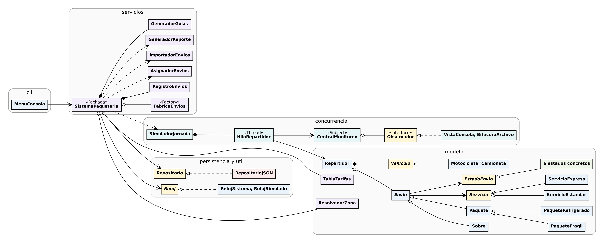

*Figura 3. Vista de conjunto de las clases*

### Elementos clave

- SistemaPaqueteria es la fachada: la terminal le habla solo a ella y ella coordina a las demás.

- Envio es la raíz de la jerarquía de tipos de envío y delega su comportamiento de estado en EstadoEnvio y de precio en Servicio.

- Repartidor tiene un Vehiculo (composición) y agrupa los Envio que le fueron asignados (agregación).

- SimuladorJornada crea un HiloRepartidor por repartidor; los hilos informan a CentralMonitoreo, que avisa a sus observadores.

- Repositorio y Reloj son abstracciones: el sistema depende de ellas y no de las clases concretas.

## 4. Modelo de envíos y tarifas

**Tipo UML:** Diagrama de clases (detalle)

**Qué muestra.** La jerarquía de envíos con sus atributos y métodos, la jerarquía de servicios y los objetos que componen un envío.

**Por qué se eligió.** Es el núcleo del dominio. Explica dónde vive cada regla de precio y de validación y por qué no hace falta ninguna cadena de if sobre el tipo de envío.

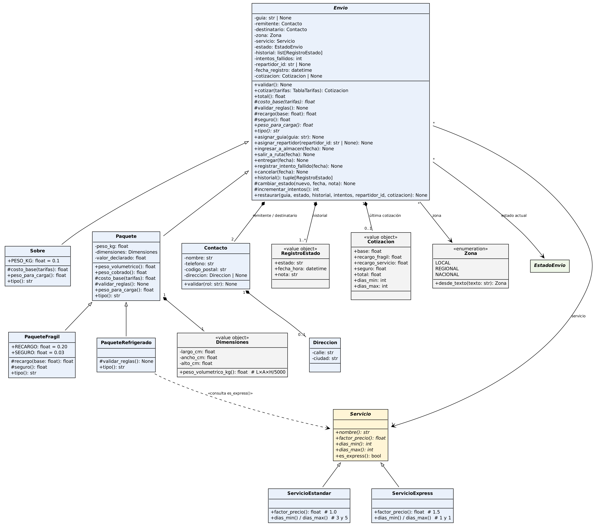

*Figura 4. Clases del modelo de envíos*

### Elementos clave

- Envio es abstracta y define cotizar() como **Template Method**: calcula base, recargo, seguro y factor del servicio. Cada subclase redefine solo costo_base(), recargo() o seguro(); validar_reglas() es un gancho vacío que solo redefinen Paquete y PaqueteRefrigerado.

- PaqueteFragil aporta el 20 % y el seguro de 3 %. PaqueteRefrigerado redefine validar_reglas() para exigir servicio express y rechazar la zona nacional.

- Servicio es la estrategia de tiempo y precio: ServicioEstandar (×1.0, 3 a 5 días) y ServicioExpress (×1.5, 1 día).

- Envio compone a dos Contacto y a su historial de RegistroEstado; Paquete compone a sus Dimensiones. El código postal es un atributo obligatorio de Contacto; la Direccion es opcional (0..1).

- Cotizacion es un objeto inmutable con el desglose del precio y los días de entrega. cotizar() guarda la última cotización en el envío; total() la usa y el reporte diario suma los ingresos con ella.

**Cálculo de la cotización**

| **Concepto**        | **Fórmula**                                                             |
|---------------------|-------------------------------------------------------------------------|
| Peso cobrado        | max(peso_kg, largo × ancho × alto / 5000)                               |
| Base                | Sobre: tarifa fija de la zona. Paquete: peso_cobrado × tarifa_kg(zona). |
| Recargo frágil      | 0.20 × base (solo PaqueteFragil)                                        |
| Recargo de servicio | (base + recargo_frágil) × (factor − 1); en express es 0.50.             |
| Seguro              | 0.03 × valor_declarado (solo PaqueteFragil)                             |
| Total               | base + recargo_frágil + recargo_servicio + seguro                       |

**Validaciones de validar_reglas():** es un gancho vacío en Envio, así que Sobre no necesita redefinirlo. Paquete lo redefine para exigir peso, medidas y valor declarado positivos, y PaqueteRefrigerado para exigir servicio express y una zona distinta de la nacional. Un código postal sin zona lo rechaza ResolvedorZona antes de crear el envío.

## 5. Estados del envío (patrón State)

**Tipo UML:** Diagrama de clases (detalle)

**Qué muestra.** Cómo se implementa el patrón State: Envio delega cada acción en su estado actual y cada estado decide si la acción es válida.

**Por qué se eligió.** Las transiciones son la parte con más reglas del enunciado (intentos fallidos, cancelación solo antes de salir a ruta). Con State cada regla queda en la clase del estado al que pertenece, y un cambio no válido se rechaza sin código condicional.

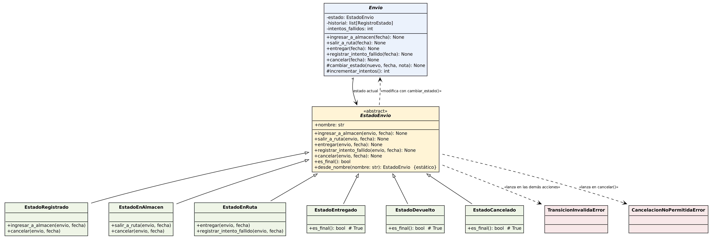

*Figura 5. Patrón State aplicado al envío*

### Elementos clave

- EstadoEnvio define todas las acciones. Por defecto, cancelar() lanza CancelacionNoPermitidaError y las demás acciones lanzan TransicionInvalidaError.

- Cada estado concreto redefine solo las acciones que permite. Por ejemplo, EstadoEnRuta redefine entregar() y registrar_intento_fallido() pero no cancelar(), así que cancelar en ruta se rechaza solo con CancelacionNoPermitidaError.

- EstadoEnRuta.registrar_intento_fallido() cuenta el intento: con menos de tres regresa al almacén y al tercero devuelve el envío al remitente.

- Los estados no guardan datos, por lo que se comparten entre envíos. EstadoEnvio.desde_nombre() reconstruye el estado al cargar los archivos.

- El cambio real lo hace Envio.cambiar_estado(), que además agrega la entrada al historial con fecha y hora.

**Acciones permitidas por estado**

| **Estado**                     | **Acciones permitidas**             | **Resultado**                                                     |
|--------------------------------|-------------------------------------|-------------------------------------------------------------------|
| Registrado                     | ingresar_a_almacen, cancelar        | EnAlmacen, Cancelado                                              |
| EnAlmacen                      | salir_a_ruta, cancelar              | EnRuta, Cancelado                                                 |
| EnRuta                         | entregar, registrar_intento_fallido | Entregado; EnAlmacen o Devuelto                                   |
| Entregado, Devuelto, Cancelado | Ninguna (estados finales)           | TransicionInvalidaError; al cancelar, CancelacionNoPermitidaError |

## 6. Servicios y operaciones del sistema

**Tipo UML:** Diagrama de clases (detalle)

**Qué muestra.** La fachada SistemaPaqueteria y las clases que realizan cada función: crear envíos, guías, registro en memoria, asignación, importación y reportes.

**Por qué se eligió.** Separa las responsabilidades para que ninguna clase haga demasiado. Es el diagrama que muestra cómo se reparte el trabajo de las funciones mínimas.

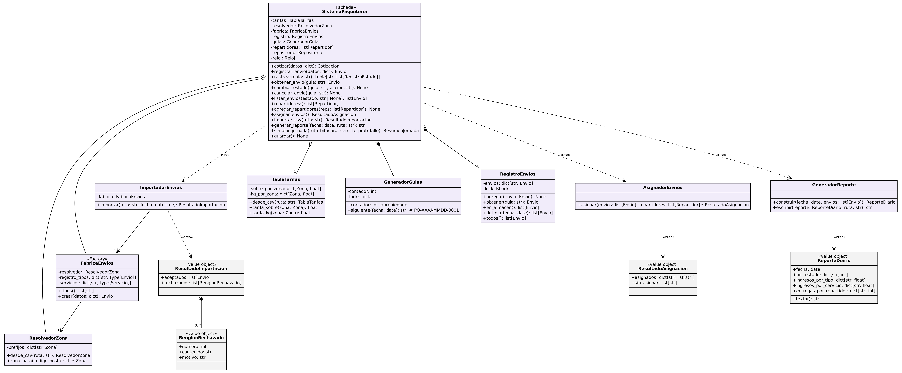

*Figura 6. Servicios, fábrica y operaciones*

### Elementos clave

- SistemaPaqueteria ofrece una operación por función mínima y delega el trabajo; no calcula precios ni lee archivos.

- FabricaEnvios crea el tipo correcto a partir de un diccionario de datos, tanto desde el menú como desde el CSV. Su registro de tipos permite agregar un tipo nuevo sin cambiar el resto.

- RegistroEnvios guarda los envíos por guía y protege los accesos con un RLock, porque varios hilos lo consultan.

- AsignadorEnvios aplica first-fit decreasing por peso y devuelve un ResultadoAsignacion con los asignados y los que no cupieron.

- ImportadorEnvios produce un ResultadoImportacion con los envíos aceptados y un RenglonRechazado por cada error (número, contenido y motivo).

- GeneradorReporte separa el cálculo (ReporteDiario) de la escritura del archivo.

- TablaTarifas y ResolvedorZona se cargan desde CSV; así las tarifas se cambian sin tocar el código.

## 7. Persistencia y reloj

**Tipo UML:** Diagrama de clases (detalle)

**Qué muestra.** Las abstracciones Repositorio y Reloj con sus implementaciones concretas, y cómo se serializan los envíos.

**Por qué se eligió.** El sistema debe conservar datos entre ejecuciones y probar reglas de fecha sin esperar. Depender de abstracciones resuelve ambas cosas y evita acoplar la lógica a JSON o al reloj del equipo.

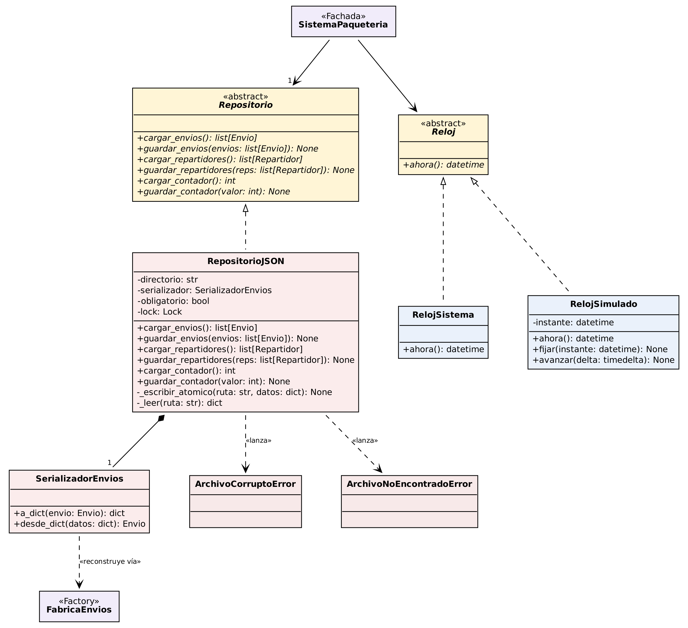

*Figura 7. Repositorio y reloj*

### Elementos clave

- Repositorio define cargar y guardar envíos, repartidores y el contador de guías. RepositorioJSON implementa los seis métodos.

- RepositorioJSON escribe de forma atómica. Si un archivo de ejecución falta, lo toma como primera ejecución; si falta un archivo obligatorio (los repartidores iniciales) lanza ArchivoNoEncontradoError, y si un archivo está dañado lanza ArchivoCorruptoError y no lo sobrescribe. En ningún caso el programa termina con un traceback.

- SerializadorEnvios convierte envíos a diccionarios y los reconstruye con FabricaEnvios y EstadoEnvio.desde_nombre(), con su historial completo.

- RelojSistema entrega la hora real; RelojSimulado permite fijarla o avanzarla para las pruebas.

## 8. Repartidores y reparto concurrente

**Tipo UML:** Diagrama de clases (detalle)

**Qué muestra.** Los repartidores y sus vehículos, y las clases de la simulación: un hilo por repartidor que informa a una central con el patrón Observer.

**Por qué se eligió.** La función 8 exige que todos los repartidores trabajen al mismo tiempo y que la central muestre el avance. El diagrama muestra quién corre en cada hilo y cómo se comunican sin mezclar la salida.

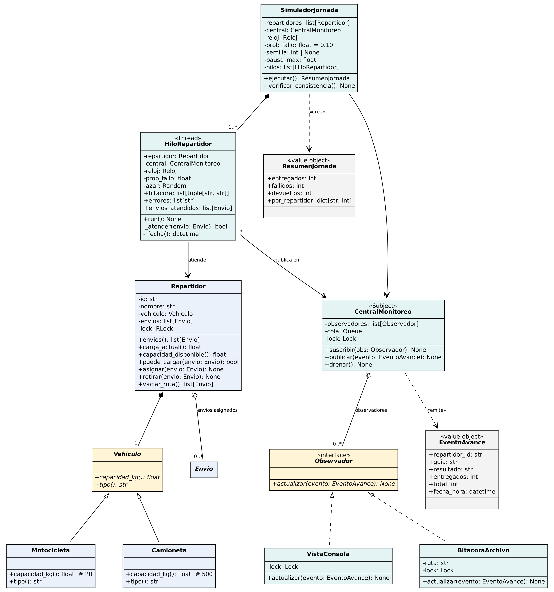

*Figura 8. Repartidores, hilos y central de monitoreo*

### Elementos clave

- Vehiculo es abstracta con Motocicleta (20 kg) y Camioneta (500 kg). Repartidor.asignar() lanza CapacidadExcedidaError si el envío no cabe.

- HiloRepartidor hereda de threading.Thread. Cada hilo recorre solo los envíos de su repartidor, de modo que dos hilos nunca modifican el mismo envío.

- CentralMonitoreo recibe los EventoAvance en una Queue (segura entre hilos) y los reparte a sus Observadores: VistaConsola imprime el avance y BitacoraArchivo lo guarda.

- SimuladorJornada espera a todos los hilos con join() y verifica que el estado de cada envío corresponda a lo ocurrido antes de crear el ResumenJornada.

**Qué se protege y con qué**

| **Recurso compartido**           | **Mecanismo**                                           |
|----------------------------------|---------------------------------------------------------|
| Contador de guías                | Lock en GeneradorGuias.siguiente()                      |
| Diccionario de envíos            | RLock en RegistroEnvios                                 |
| Lista de envíos de un repartidor | RLock en Repartidor                                     |
| Eventos de avance                | Queue en CentralMonitoreo                               |
| Impresión en pantalla            | Lock en VistaConsola, para que las líneas no se mezclen |
| Archivos JSON                    | Lock y escritura atómica en RepositorioJSON             |

## 9. Jerarquía de excepciones

**Tipo UML:** Diagrama de clases (detalle)

**Qué muestra.** Las excepciones propias del sistema y su relación de herencia.

**Por qué se eligió.** El enunciado prohíbe que un dato inválido o un archivo dañado termine el programa con un traceback. Una jerarquía propia permite capturar todos los errores del sistema con PaqueteriaError y, a la vez, distinguir cada causa.

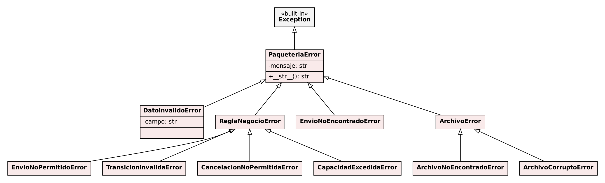

*Figura 9. Excepciones propias*

**Cuándo se lanza cada excepción**

| **Excepción**               | **Se lanza cuando…**                                                                           | **La captura**   |
|-----------------------------|------------------------------------------------------------------------------------------------|------------------|
| DatoInvalidoError           | Un dato tiene tipo o valor incorrecto (peso negativo, código postal sin zona).                 | Menú, importador |
| EnvioNoPermitidoError       | El envío incumple una regla de negocio (refrigerado en zona nacional o con servicio estándar). | Menú, importador |
| TransicionInvalidaError     | Se pide un cambio de estado que el estado actual no permite.                                   | Menú             |
| CancelacionNoPermitidaError | Se cancela un envío que ya salió a ruta o es final.                                            | Menú             |
| CapacidadExcedidaError      | Un envío no cabe en la capacidad del vehículo.                                                 | Asignador        |
| EnvioNoEncontradoError      | La guía no existe.                                                                             | Menú             |
| ArchivoNoEncontradoError    | Falta un archivo de datos o de entrada.                                                        | Menú, arranque   |
| ArchivoCorruptoError        | Un archivo existe pero su contenido no se puede leer.                                          | Menú, arranque   |

ReglaNegocioError y ArchivoError son clases base: agrupan las reglas de negocio y los problemas de archivos para capturarlos juntos (el diagrama 13 usa ArchivoError).

main.py envuelve la ejecución en un try/except PaqueteriaError que imprime el mensaje y continúa o termina de forma ordenada. Un Exception genérico queda solo como última red de seguridad en el menú, para no mostrar un traceback.

## 10. Ciclo de vida de un envío

**Tipo UML:** Diagrama de máquina de estados

**Qué muestra.** Los estados por los que pasa un envío, los eventos que provocan cada cambio y las condiciones que los guardan.

**Por qué se eligió.** El enunciado describe un comportamiento que depende del estado y del número de intentos fallidos. Una máquina de estados es el diagrama indicado para ese caso y es la especificación que implementan las clases del diagrama 5.

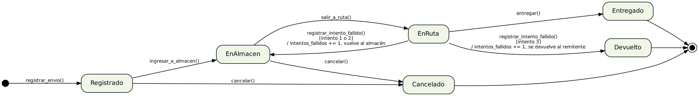

*Figura 10. Máquina de estados de un envío*

### Elementos clave

- Cada flecha se rotula evento \[condición\] / acción, con los nombres reales de los métodos de Envio.

- Solo Registrado y EnAlmacen aceptan cancelar(): una vez que el envío sale a ruta ya no puede cancelarse.

- Desde EnRuta, cada intento fallido suma 1 a intentos_fallidos. En el primero y el segundo, el envío regresa al almacén; en el tercero, termina en Devuelto. La condición se revisa después de sumar.

- Entregado, Devuelto y Cancelado son estados finales.

## 11. Cotizar y registrar un envío

**Tipo UML:** Diagrama de secuencia

**Qué muestra.** El intercambio de mensajes desde que el operador captura los datos hasta que el sistema entrega la guía y el total.

**Por qué se eligió.** La función 1 reúne varias clases (fábrica, envío, guías, registro, repositorio). Este diagrama muestra el orden de las llamadas y confirma quién crea, quién valida y quién guarda.

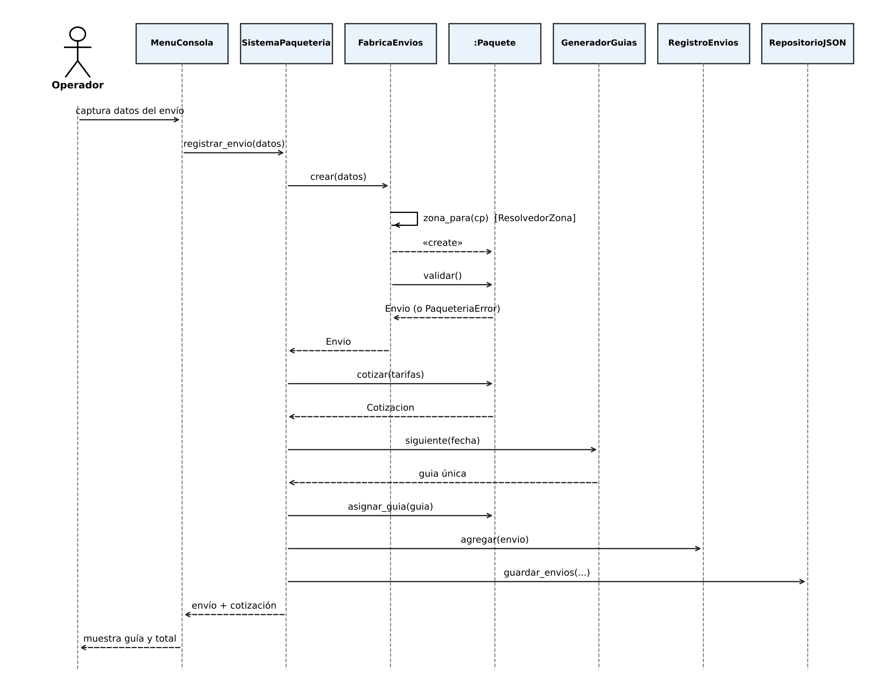

*Figura 11. Secuencia de registro de un envío*

### Elementos clave

- FabricaEnvios resuelve la zona, crea el envío y lo valida; si una regla falla, el error sube como PaqueteriaError y no se consume una guía.

- cotizar() solo calcula; la guía se pide a GeneradorGuias únicamente al registrar, por lo que cotizar no gasta números.

- SistemaPaqueteria guarda con el repositorio al final, para que los datos queden en disco antes de confirmar al usuario.

## 12. Jornada de reparto concurrente

**Tipo UML:** Diagrama de secuencia

**Qué muestra.** Cómo interactúan el simulador, los hilos de los repartidores, los envíos y la central durante la jornada. El recuadro par marca lo que ocurre al mismo tiempo.

**Por qué se eligió.** La concurrencia es la parte más delicada del sistema. Este diagrama muestra qué se ejecuta en paralelo, qué espera con join() y dónde se comunican los hilos.

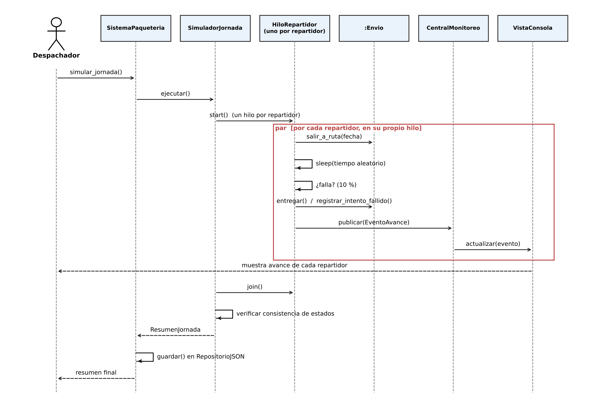

*Figura 12. Secuencia de la simulación de reparto*

### Elementos clave

- SimuladorJornada inicia un hilo por repartidor y los espera a todos antes de calcular el resumen.

- Dentro de cada hilo: salir a ruta, esperar un tiempo aleatorio, decidir si la entrega falla (10 %), cambiar el estado del envío y publicar un EventoAvance.

- Los hilos solo dejan cada evento en la cola de la central; el hilo principal la vacía con drenar() y avisa a VistaConsola y BitacoraArchivo. Así la salida se muestra en orden y sin que los hilos escriban a la vez.

- Al terminar, SimuladorJornada verifica que el estado de cada envío corresponda a lo ocurrido: un envío con tres fallos debe estar en Devuelto y uno entregado, en Entregado.

## 13. Importación de envíos desde CSV

**Tipo UML:** Diagrama de actividad

**Qué muestra.** El flujo de la función 5: abrir el archivo, procesar renglón por renglón y separar los envíos válidos de los rechazados.

**Por qué se eligió.** Es un algoritmo con decisiones y un ciclo, y el diagrama de actividad es el que mejor lo expresa. También muestra que un renglón inválido no detiene la importación.

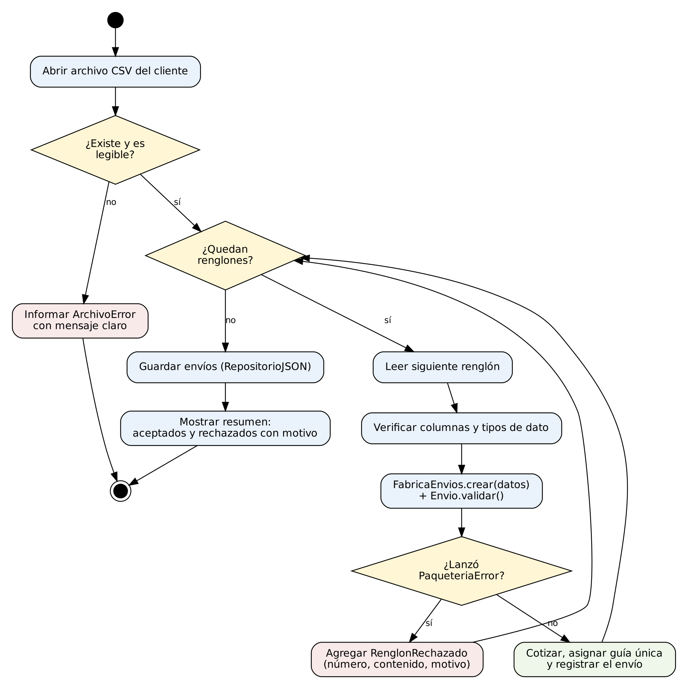

*Figura 13. Actividad de importación de un CSV*

### Elementos clave

- Un archivo inexistente o ilegible termina con un mensaje claro de ArchivoError; no hay traceback.

- Cada renglón pasa por FabricaEnvios.crear() y Envio.validar(). Si lanza PaqueteriaError, se agrega un RenglonRechazado con el número de renglón, su contenido y el motivo.

- Los renglones válidos se cotizan, reciben guía y se registran; después se guardan todos los cambios.

- El resumen final lista los aceptados y, uno por uno, los rechazados con su motivo, como exige el enunciado.

# 5. Trazabilidad con las funciones mínimas

| **Función mínima**                     | **Clases principales**                                              | **Diagramas** |
|----------------------------------------|---------------------------------------------------------------------|---------------|
| 1\. Cotizar y registrar con guía única | SistemaPaqueteria, FabricaEnvios, Envio y subclases, GeneradorGuias | 4, 6, 11      |
| 2\. Rastrear una guía                  | RegistroEnvios, Envio, RegistroEstado                               | 4, 10         |
| 3\. Cambiar el estado (y cancelar)     | EstadoEnvio y los seis estados, Envio                               | 5, 10         |
| 4\. Asignar envíos a repartidores      | AsignadorEnvios, Repartidor, Vehiculo                               | 6, 8          |
| 5\. Importar CSV de clientes           | ImportadorEnvios, ResultadoImportacion, RenglonRechazado            | 6, 13         |
| 6\. Reporte diario                     | GeneradorReporte, ReporteDiario                                     | 4, 6          |
| 7\. Conservar datos entre ejecuciones  | Repositorio, RepositorioJSON, SerializadorEnvios                    | 7             |
| 8\. Simular una jornada de reparto     | SimuladorJornada, HiloRepartidor, CentralMonitoreo, Observador      | 8, 12         |
| Cargar tarifas y zonas desde CSV       | TablaTarifas, ResolvedorZona                                        | 4, 6          |
| Datos inválidos y archivos dañados     | Jerarquía PaqueteriaError                                           | 9             |

# 6. Tabla de decisiones de diseño

| **Concepto**                 | **Dónde se usa**                                                                                                                                                                                       | **Qué problema resuelve**                                                                                                                |
|------------------------------|--------------------------------------------------------------------------------------------------------------------------------------------------------------------------------------------------------|------------------------------------------------------------------------------------------------------------------------------------------|
| Encapsulamiento              | Envio (el estado y el historial solo cambian con sus métodos; historial() devuelve una tupla), Repartidor (la carga solo cambia con asignar() y retirar()), TablaTarifas, objetos de valor inmutables. | Evita estados inconsistentes, historiales alterados y vehículos sobrecargados.                                                           |
| Herencia y clases abstractas | Envio → Sobre, Paquete → PaqueteFragil, PaqueteRefrigerado; Servicio, Vehiculo, EstadoEnvio, Repositorio, Reloj, Observador, PaqueteriaError.                                                          | Comparte atributos y comportamiento común (Paquete) y fija el contrato que deben cumplir las variantes.                                  |
| Composición y agregación     | Envio compone Contacto, RegistroEstado; Paquete compone Dimensiones; Repartidor compone Vehiculo y agrega Envio; SistemaPaqueteria compone RegistroEnvios y agrega la fábrica y las tablas.            | Modela relaciones todo-parte y decide quién controla el ciclo de vida de cada objeto.                                                    |
| Polimorfismo                 | Envio.cotizar() con hooks por tipo, EstadoEnvio en cada transición, Vehiculo.capacidad_kg(), Servicio.factor_precio(), Reloj.ahora(), Repositorio, Observador.actualizar().                            | Elimina cadenas de if/elif por tipo y permite agregar variantes sin modificar el código existente.                                       |
| Excepciones                  | Jerarquía PaqueteriaError; main.py y el menú las capturan.                                                                                                                                             | Los datos inválidos y los archivos faltantes o dañados se informan con un mensaje claro y el programa continúa.                          |
| Archivos                     | CSV de tarifas, zonas e importación de envíos; JSON de envíos, historial, repartidores y contador; reporte diario y bitácora en texto.                                                                 | Datos configurables sin tocar el código y conservación entre ejecuciones.                                                                |
| Hilos                        | HiloRepartidor; Lock y RLock en GeneradorGuias, RegistroEnvios, Repartidor, RepositorioJSON; Queue en CentralMonitoreo.                                                                                | Simula repartidores simultáneos sin guías repetidas, estados inconsistentes ni salida mezclada.                                          |
| Patrones de diseño           | State (estados), Template Method (cotizar), Strategy (Servicio), Factory (FabricaEnvios), Observer (central), Facade (SistemaPaqueteria), Repository (persistencia).                                   | Cada patrón resuelve un problema concreto del sistema: transiciones, cálculo, creación, notificación, punto de entrada y almacenamiento. |

# 7. Principios SOLID aplicados

| **Principio**                | **Cómo se cumple en el diseño**                                                                                                                                       |
|------------------------------|-----------------------------------------------------------------------------------------------------------------------------------------------------------------------|
| S: responsabilidad única     | GeneradorReporte, ImportadorEnvios, AsignadorEnvios y GeneradorGuias hacen una sola tarea; SistemaPaqueteria solo coordina.                                           |
| O: abierto/cerrado           | Un tipo de envío nuevo es una subclase y un registro en FabricaEnvios; un servicio nuevo es una subclase de Servicio; un estado nuevo es una subclase de EstadoEnvio. |
| L: sustitución de Liskov     | Cualquier Envio se cotiza y se valida igual; cualquier Vehiculo, Repositorio o Reloj puede sustituir a su abstracción.                                                |
| I: segregación de interfaces | Observador tiene un solo método; Reloj y Repositorio son contratos pequeños.                                                                                          |
| D: inversión de dependencias | SistemaPaqueteria recibe un Repositorio y un Reloj por su constructor y no crea clases concretas.                                                                     |

# 8. Alternativas consideradas

| **Decisión**            | **Opción A**                                                | **Opción B**                            | **Elegida y por qué**                                                                                                                                       |
|-------------------------|-------------------------------------------------------------|-----------------------------------------|-------------------------------------------------------------------------------------------------------------------------------------------------------------|
| Estados del envío       | Atributo con el nombre del estado y if/elif en cada método. | Patrón State, una clase por estado.     | B. Hay reglas distintas por estado (intentos fallidos, cancelación). Con A habría que repetir las condiciones en cada método; el costo es tener más clases. |
| Tipos de envío          | Una sola clase Envio con un campo tipo.                     | Jerarquía de herencia con polimorfismo. | B. Cada tipo tiene datos y reglas propios (peso, seguro, restricciones del refrigerado). Con A, cotizar() crecería con cada tipo nuevo.                     |
| Formato de persistencia | CSV, uno por entidad.                                       | JSON.                                   | JSON. Guarda el historial anidado de cada envío sin archivos auxiliares; CSV se reserva para la entrada de tarifas y importación de envíos de clientes.     |
| Concurrencia            | Un hilo por envío.                                          | Un hilo por repartidor.                 | Por repartidor. Refleja el problema real (cada repartidor recorre su ruta) y evita que dos hilos modifiquen el mismo envío.                                 |

# 9. Mapa de clases a módulos

| Módulo                                     | Clases                                                                                                         |
|--------------------------------------------|----------------------------------------------------------------------------------------------------------------|
| paqueteria/modelo/envio.py                 | Envio, Sobre, Paquete, PaqueteFragil, PaqueteRefrigerado                                                       |
| paqueteria/modelo/estados.py               | EstadoEnvio, EstadoRegistrado, EstadoEnAlmacen, EstadoEnRuta, EstadoEntregado, EstadoDevuelto, EstadoCancelado |
| paqueteria/modelo/servicio.py              | Servicio, ServicioEstandar, ServicioExpress                                                                    |
| paqueteria/modelo/contacto.py              | Contacto, Direccion                                                                                            |
| paqueteria/modelo/valores.py               | Zona, Dimensiones, RegistroEstado, Cotizacion                                                                  |
| paqueteria/modelo/vehiculo.py              | Vehiculo, Motocicleta, Camioneta                                                                               |
| paqueteria/modelo/repartidor.py            | Repartidor                                                                                                     |
| paqueteria/modelo/tarifas.py               | TablaTarifas, ResolvedorZona                                                                                   |
| paqueteria/servicios/sistema.py            | SistemaPaqueteria                                                                                              |
| paqueteria/servicios/fabrica.py            | FabricaEnvios                                                                                                  |
| paqueteria/servicios/registro.py           | RegistroEnvios                                                                                                 |
| paqueteria/servicios/guias.py              | GeneradorGuias                                                                                                 |
| paqueteria/servicios/asignador.py          | AsignadorEnvios, ResultadoAsignacion                                                                           |
| paqueteria/servicios/importador.py         | ImportadorEnvios, ResultadoImportacion, RenglonRechazado                                                       |
| paqueteria/servicios/reportes.py           | GeneradorReporte, ReporteDiario                                                                                |
| paqueteria/concurrencia/simulador.py       | SimuladorJornada, ResumenJornada                                                                               |
| paqueteria/concurrencia/hilo_repartidor.py | HiloRepartidor                                                                                                 |
| paqueteria/concurrencia/central.py         | CentralMonitoreo, EventoAvance                                                                                 |
| paqueteria/concurrencia/observadores.py    | Observador, VistaConsola, BitacoraArchivo                                                                      |
| paqueteria/persistencia/                   | repositorio.py: Repositorio; repositorio_json.py: RepositorioJSON; serializador.py: SerializadorEnvios         |
| paqueteria/util/reloj.py                   | Reloj, RelojSistema, RelojSimulado                                                                             |
| paqueteria/excepciones/errores.py          | PaqueteriaError y todas sus subclases                                                                          |
| paqueteria/cli/                            | main.py (argparse), menu.py: MenuConsola                                                                       |
| paqueteria/\_\_main\_\_.py                     | Sin clases: permite ejecutar con `python -m paqueteria`                                                        |

**Estructura del repositorio**

```
Proyecto-POO-Brigada-8/
├── README.md
├── .gitignore
├── docs/
│   ├── diseno.md
│   └── uml/            imágenes de los diagramas y fuentes .dot
├── datos/              tarifas, zonas, repartidores y CSV con y sin errores
├── tests/              pruebas con unittest
└── paqueteria/
    ├── __init__.py
    ├── __main__.py
    ├── cli/
    ├── modelo/
    ├── servicios/
    ├── concurrencia/
    ├── persistencia/
    ├── util/
    └── excepciones/
```

# 10. Uso de IA

> Revisen y ajusten esta sección para que diga exactamente lo que hicieron.

- **Qué le pedimos.** Usamos Claude (Anthropic) como asistente. Le pedimos ayuda para arrancar el diseño a partir del enunciado del Tema 3, revisar los diagramas UML y encontrar inconsistencias entre ellos y con el código, resolver dudas concretas de Python y de programación orientada a objetos, y sobre todo para depurar: identificar la causa de los errores que nos iban saliendo, entender los mensajes de excepción y corregir casos que no habíamos contemplado.
- **Qué usamos de sus respuestas.** La propuesta de clases y patrones (State, Template Method, Strategy, Factory, Observer, Facade y Repository), los diagramas, el código de los paquetes `paqueteria/` y `tests/`, los datos de ejemplo y el borrador de este documento y del README.
- **Qué corregimos.** En la revisión del diseño se corrigieron doce inconsistencias: el precio no se guardaba en el envío (el reporte no podía sumar ingresos), `validar_reglas()` era abstracto pero `Sobre` y `Paquete` no lo implementaban, el código postal dependía de una dirección opcional, la condición del tercer intento fallido regresaba el envío al almacén en lugar de devolverlo, `RepositorioJSON` no implementaba los métodos del contador de guías, entre otras. Al programar se ajustaron firmas de métodos (por ejemplo, `importar(ruta, fecha)` y `simular_jornada(...)`) y se actualizaron los diagramas 4 a 8 y 10 para que coincidan con el código.
- **Cómo verificamos.** Corrimos las 29 pruebas unitarias (`python -m unittest`), ejecutamos cada función con los datos de ejemplo, incluidos los casos que deben rechazarse y los archivos faltantes o dañados, y comprobamos a mano los cálculos de precio (por ejemplo, el paquete frágil express de la sección 4: 312 + 62.40 + 187.20 + 30 = 591.60).

# 11. Contribuciones


| Integrante | Contribución |
|---|---|
| Mora Chávez Héctor Cristóbal | Participó en todas las etapas del proyecto:  diseño y diagramas UML, desarrollo del código (modelo, servicios, persistencia, concurrencia e interfaz de línea de comandos), pruebas unitarias, datos de ejemplo y documentación (README y documento de diseño). |
| Rodríguez González Adrián | Implementé los paquetes servicios (fachada SistemaPaqueteria, FabricaEnvios, registro y guías sincronizadas, asignación de envíos, importación CSV y reportes diarios), concurrencia (simulación de reparto con hilos por repartidor y monitoreo con el patrón Observer y Queue) y cli (menú interactivo, argumentos con argparse y captura global de errores). |
| Cerritos Serrano Angélica | (completar) |
| Angel Emanuel Jose Juarez | Colaboré en el diseño e implementación de la arquitectura del sistema, aplicando patrones de diseño para desacoplar responsabilidades. Específicamente, me encargué de la jerarquía de envíos (implementando el patrón Template Method para el cálculo de tarifas y Strategy para los servicios) y desarrollé la máquina de estados del envío usando el patrón State para gestionar transiciones e intentos fallidos|
